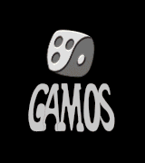

<p align="center">
  
</p>

# Gamos Game Engine Reanimated (GGER)

GGER is a behavioral re-creation of the **Gamos 1.51** game runtime, rebuilt in
portable C11 and SDL3 from the 1998 **NetWalk** release. The recovered VM,
fixed data-window layout, save format, and game logic are implemented in C; the
original Win32 and rendering layers are replaced by SDL3 and small platform
layers.

The current game integration is NetWalk. FlipFlop is the second verified
Gamos 1.51 release and is used to confirm that the recovered runtime is shared
by both titles.

GGER builds five targets from one source tree:

- **Linux x86-64**: dynamically linked ELF with runtime-loaded X11 and static
  PulseAudio.
- **Windows x86-64**: MinGW-w64 executable with SDL3 compiled from the
  vendored source.
- **PlayStation 5**: native title (`PPSA99877`) with a signed `eboot.bin`.
- **Android**: `arm64-v8a` and `x86_64` APK with a centered 4:3 game view,
  immersive full screen, and touch controls that use the black bars when they
  fit and a pull-down card otherwise.
- **iOS**: arm64 `.app`/`.ipa` cross-built in Docker from a user-supplied Apple
  SDK, with optional ad-hoc or Apple signing. Touch uses SDL's touch-to-mouse
  bridge, and the same bar/card control layout is available in both
  orientations.

## Reference releases

| Release | Size (bytes) | SHA-256 |
| --- | ---: | --- |
| `NetWalk v1.51 (Eng)` | 4,979,981 | `258d7406ea98bf3088e90d8dd9988fbdc2e270ad75869a2a584c429855bffb9d` |
| `Flip Flop v1.51 (Eng)` | 4,633,340 | `b6e34011349cd2de386914bba542dc05c81a66cfe013827f77b2889d9beeb1b2` |

NetWalk is the original source of the disassembly. The executables and extracted
game data are not included. See [docs/PROVENANCE.md](docs/PROVENANCE.md) for
verification details.

## Quick start

Prerequisites are CMake 3.21 or newer, Ninja, Python 3, and a C11 compiler.
Windows also needs a MinGW C++ compiler for SDL3. Platform-specific SDKs and
packages are listed in
[docs/BUILD.md](docs/BUILD.md).

The build needs `assets/overlay.nw`, which is generated from the reference game
and is ignored by Git. If you have the original `NETWALK.EXE`, extract it once:

```sh
python3 tools/nwextract.py /path/to/NETWALK.EXE -o extracted/NETWALK
cp extracted/NETWALK/overlay.nw assets/overlay.nw
```

Without that file the code still compiles, but the game cannot be played until
an overlay is supplied.

```sh
cmake --preset linux-x86_64
cmake --build --preset linux-x86_64

# Run from the build directory so overlay.nw and gm.sf2 are found.
cd build/linux-x86_64
./NETWALK.EXE
```

### Docker build

With Docker installed, choose one of these paths.

**No original game data (compile check only)**

```sh
docker/build-releases.sh --no-overlay
```

This builds Linux and Windows without `overlay.nw`. PS5, Android, and iOS are
skipped by default; add `--ps5` to include the native PS5 title. The executables
are not playable until an overlay is placed beside them.

**With an original `NETWALK.EXE`**

```sh
docker/build-releases.sh /path/to/NETWALK.EXE
```

The wrapper extracts `overlay.nw` inside the container, builds Linux and
Windows, and names the Linux and Windows executables after the lowercased
reference filename. With `NETWALK.EXE`, both desktop directories contain
`netwalk.exe`. Add `--ps5` for the native PS5 title. To include an Android APK,
add `--android-debug` for a debug-signed APK; for a release-signed APK, export
the four `NW_ANDROID_*` variables and pass `--android`. iOS is opt-in: pass
`--ios` with `--ios-sdk` (an `iPhoneOS.sdk`, `Xcode.app`, or `.xip`) and an
overlay to stage `ios/NetWalk.ipa`. Outputs are staged under
`dist/docker-releases/`.

Run the Linux build with:

```sh
cd dist/docker-releases/linux-x86_64
./netwalk.exe
```

The first run builds `netwalk-build:latest`. See
[docker/README.md](docker/README.md) for signing, overlay, and target-selection
options.

Windows, PS5, Android, iOS, debug builds, and release signing are covered in
[docs/BUILD.md](docs/BUILD.md), [docs/PS5.md](docs/PS5.md), and
[docker/README.md](docker/README.md).

## Documentation

| Document | Contents |
| --- | --- |
| [Build and platform targets](docs/BUILD.md) | Prerequisites, presets, Android/iOS/PS5/Windows builds, signing, Docker |
| [Controls](docs/CONTROLS.md) | Keyboard, mouse, gamepad, PS5 IME, Android touch controls |
| [Saves and first-run behavior](docs/SAVES.md) | Save format, first-run creation, Android/PS5 paths |
| [Architecture](docs/ARCHITECTURE.md) | Source layout, portableizer, platform layers, rendering |
| [Provenance and reference verification](docs/PROVENANCE.md) | Verified release hashes, section checks, disassembly access |
| [Conversion notes](docs/CONVERSION.md) | Naming policy, assembly removal, cleanup rules |
| [Function map](docs/reference/FUNCTION_MAP.md) | Original address to replacement unit index |
| [Asset pipeline](docs/assets/EXTRACTION.md) | Overlay extraction, sprite dumps, high-resolution packs |
| [Testing](docs/TESTING.md) | Build gates, packaging checks, runtime checks |
| [Developer tools](tools/documentation/README.md) | Per-tool reference and Python environment |
| [Docker release builds](docker/README.md) | Reproducible Linux, Windows, Android, iOS, and PS5 packaging |

## Naming

GGER is the project name; the NetWalk game and internal `NW`/`netwalk` identifiers keep their existing names.

## License

The reconstructed source and documentation are MIT-licensed; see
[LICENSE](LICENSE). Third-party components retain their upstream licenses.
